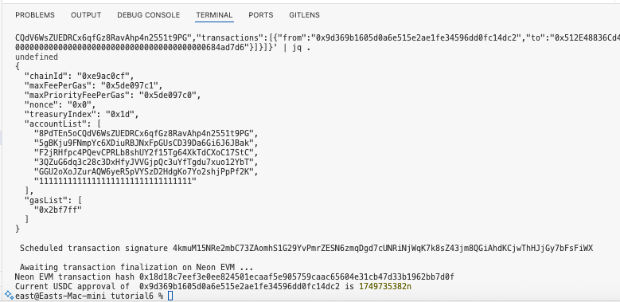

# Neon Bootcamp - Tutorial 6

# Sample scripts for Solana Native SDK by Neon EVM
 
1. Copy the scripts and create a new repo with them to run and test how they work.
2. Observe:
- Gas estimation
- Balance changes
- tx hash resolution from Neon RPC

You don’t need to write your own script to submit the task—but playing with the code is highly recommended!
Once done, push your scripts to GitHub and submit the repo link including a README with your observations about how approval and transfer logic work with Solana Native SDK.

